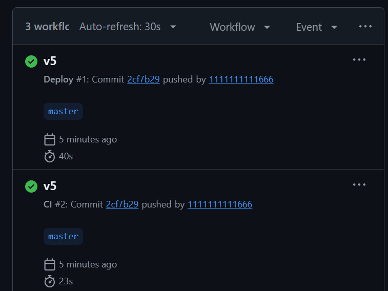

# Протокол ручной проверки приложения и доказательства CI/CD

**Проект:** Учебный проект «Бронь без конфликтов» (Разработка веб-сервиса бронирования ресурсов)
**Дата проверки:** 21.10.2026
**Среда тестирования:** Локальный запуск. PostgreSQL 16 (Docker), Node.js 24, Express, Vanilla JS. Браузер: Chrome (обычный профиль + Incognito).
**Тестовые аккаунты:** `user1`, `user2`, `admin` (пароль: `Passw0rd!`).

---

## Часть 1. Обязательные проверки функционала

Для каждой проверки указано: условия, действие, ожидаемый и фактический результат.

| № | Условия и действие | Ожидание | Фактический результат |
|---|---|---|---|
| 1 | Корректное бронирование (user1, свободный интервал) | Одна запись, подтверждение в интерфейсе (экран успеха с номером) | **Успешно (201 Created).** Бронь создана, появился экран успеха с ID, датой и временем (МСК). |
| 2 | Конец раньше начала (end <= start) | 400, записи нет | **Успешно (400).** Ошибка: «Окончание должно быть позже начала». Запись не создана. |
| 3 | Начало в прошлом | 400, записи нет | **Успешно (400).** Ошибка: «Начало не может быть в прошлом». Запись не создана. |
| 4 | Неверный шаг времени (например, 10:00–10:45) | 400, записи нет | **Успешно (400).** Ошибка: «Шаг времени — 30 минут». Запись не создана. |
| 5 | Длительность более 4 часов (например, 5 часов) | 400, записи нет | **Успешно (400).** Ошибка: «Длительность от 30 минут до 4 часов». Запись не создана. |
| 6 | Вне окна работы (например, 07:30–08:30 МСК) | 400, записи нет | **Успешно (400).** Ошибка: «Бронирование доступно с 08:00 до 22:00 МСК». Запись не создана. |
| 7 | Пересечение времени одного ресурса (user2 бронирует поверх user1) | 409, второй активной записи нет | **Успешно (409).** Ошибка: «Ресурс уже занят в выбранное время». Список занятых интервалов перезагрузился. |
| 8 | Соседние интервалы (бронь 10:00–11:00, затем 11:00–12:00) | Создание разрешено | **Успешно (201).** Созданы обе брони, конфликта нет (правило `[start, end)`). |
| 9 | Разные ресурсы на одно и то же время | Создание разрешено | **Успешно (201).** Брони на разные ресурсы на одно время не конфликтуют. |
| 10 | Два конкурентных запроса на один интервал (тест `node scripts/race.js`) | Одна запись; один успех (201), один конфликт (409) | **Успешно.** Один запрос получил 201, второй — 409. В БД ровно одна активная запись. |
| 11 | Повтор одного ключа идемпотентности и данных | Исходная запись, без дубликата | **Успешно.** Вернулся статус 200, тот же `id` записи. Заголовок `X-Idempotent-Replay: true`. |
| 12 | Прежний ключ идемпотентности с другими данными | 409 IDEMPOTENCY_MISMATCH | **Успешно (409).** Ошибка несовпадения ключа. Дубль не создан. |
| 13 | Чужая запись (user1 пытается прочитать бронь user2 по ID) | 404, данные не раскрыты | **Успешно (404 NOT_FOUND).** Данные не возвращены. |
| 14 | Чужая отмена (user1 пытается отменить бронь user2) | 404, данные не изменены | **Успешно (404 NOT_FOUND).** Статус брони не изменился. |
| 15 | Административная функция обычным пользователем (user1 идет в `/api/admin/bookings`) | 403 | **Успешно (403 FORBIDDEN).** Доступ закрыт. Через UI редирект на каталог. |
| 16 | Истёкший JWT или отсутствие JWT | 401, предложение входа | **Успешно (401 NO_TOKEN/BAD_TOKEN).** Фронтенд автоматически перенаправляет на страницу входа. |
| 17 | Отмена своей будущей записи | Время освобождено, история сохранена | **Успешно.** Статус изменен на Cancelled, бронь пропала из занятых интервалов, время можно забронировать снова. |
| 18 | Отмена начавшейся записи | Отказ без изменения (409 ALREADY_STARTED) | **Успешно (409).** Ошибка «Нельзя отменить начавшуюся или завершённую запись». В UI кнопка отмены скрыта. |
| 19 | Отключённый ресурс | Новая запись не создаётся (409 RESOURCE_DISABLED) | **Успешно (409).** Ресурс пропал из каталога. Попытка брони через API вернула ошибку. |
| 20 | Потеря сети и повтор отправки | Данные формы сохранены; дубликата нет | **Успешно.** В режиме Offline форма сохранила значения. При отправке показана ошибка сети. При включении сети и повторном клике создана ровно одна бронь. |

---

## Часть 2. Дополнительные проверки (архитектура и безопасность)

| № | Проверка | Ожидание | Фактический результат |
|---|---|---|---|
| 21 | Повторная отмена той же брони | 200, `already_cancelled: true`, без нового события аудита | **Успешно.** В таблице `audit_events` появилось только одно событие `booking.cancel`. |
| 22 | Админ отменяет чужую бронь без причины | 400 VALIDATION | **Успешно (400).** Ошибка «Администратор должен указать причину отмены». |
| 23 | Админ отменяет чужую бронь с причиной | 200, `cancelled_by`, `cancel_reason` сохранены | **Успешно.** В БД сохранился ID админа, время отмены и текст причины. |
| 24 | XSS в названии ресурса (``) | alert не появляется, текст экранирован | **Успешно.** Тег выведен как обычный текст (`escapeHtml`), скрипт не выполнился. |
| 25 | Идемпотентность при гонке (`node scripts/race-idem.js`) | Один id, без 500 | **Успешно.** Два одновременных запроса с одним ключом вернули один `id`, дубля в БД нет. |
| 26 | `/health/live` | 200 | **Успешно (200).** `{"status":"ok"}`. |
| 27 | `/health/ready` при остановленной БД | 503, без деталей | **Успешно (503).** `{"status":"not ready"}`. |
| 28 | 404 для `/api/nope` | JSON `{code:"NOT_FOUND",traceId}` | **Успешно.** Единый формат ошибки с `traceId`. |
| 29 | 500 не раскрывает детали | `{code:"INTERNAL",message:"Внутренняя ошибка сервера"}` | **Успешно.** Внутренняя ошибка скрыта от клиента, `traceId` передан. |
| 30 | В логах нет пароля/токена/Authorization | `[REDACTED]` | **Успешно.** `pino` скрывает чувствительные данные. |

---

## Часть 3. Проверка конкурентных запросов (Механизм `FOR UPDATE`)

* **Действие:** Запуск теста `node scripts/race.js`  
* **Результат:** Один запрос получает `201 Created`, второй — `409 Conflict`.
* **Доказательство:** В коде (`services/booking.js`) создание обернуто в транзакцию `withTransaction`, перед проверкой занятости выполняется `SELECT ... FOR UPDATE` по строке ресурса. Это блокирует доступ второму запросу до завершения первого. БД гарантирует, что на один интервал будет только одна активная бронь (проверено запросом в БД).

---

## Часть 4. Доказательства CI/CD

### 4.1. Успешный пайплайн (Зеленый)
* **Событие:** Коммит с исправлениями отправлен в ветку `master`.
* **Результат:** CI (сборка, линтер, проверка синтаксиса) и Deploy (сборка Docker-образа) прошли успешно.
* **Артефакты:** Сформирован артефакт `server-src`.

### 4.2. Блокировка публикации при ошибке (Красный)
* **Событие:** Во временной ветке `broken-build` в файл сервера намеренно внесена синтаксическая ошибка.
* **Результат:** Пайплайн CI упал на шаге «Syntax check». Публикация (Deploy) не запустилась. Это доказывает, что конвейер защищает прод-среду от попадания сломанного кода.

*(Вставить скриншот 2: Красный крестик в GitHub Actions на ветке broken-build)*

---

## Часть 5. Резервное копирование и восстановление БД

*(Этот раздел заполняется после выполнения шага 19. Пока что оставьте место, ниже инструкция, как это проверить).*